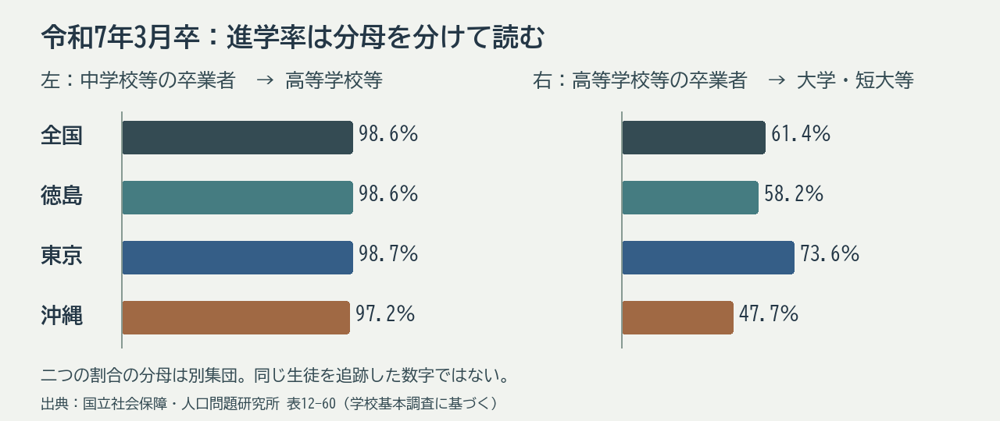

# 第4回 工業教育の歴史と地域社会と進路

2026年11月6日・本文改訂版。再編案の回番号です。用語と理由の説明、具体例、考える時間の順に読みます。

## 到達目標

- 工業教育の変化を産業・地域との関係で大づかみに説明できる。
- 進学・進路のグラフの対象と分母を確かめて読める。

## 言葉を使って確かめる

**割合の分母**　卒業者100人のうち20人が進学した、という架空の例で、20％は何に対する割合ですか。

**答え**　卒業者100人に対する割合です。別の資料と比べるときは、誰を分母にし、どの進学先を数えたかを見ます。

## 歴史の変化と進学率の読み方

工業教育の歴史は、産業に必要な人を育てる仕組みと、若者が学ぶ機会の両方から捉えます。近代の実業学校と戦後の新制高等学校では、学校制度上の位置や進学の経路が異なります。現在の学校名を過去へそのまま当てはめず、対象時期の制度の中で読むことが必要です。設備や材料の整備も、実験・実習を成り立たせる教育条件です。

進学率は「進学した人数÷対象となる人数」で考えます。例えば架空の中学校卒業者100人のうち98人が高校等へ進み、その後の別の集計で高校卒業者80人のうち48人が大学等へ進んだとします。98％と60％では分母が異なり、この二表から同じ100人の最終的な進路を追跡することはできません。卒業年や調査対象の違いも確認します。

全国と徳島に加えて、東京と沖縄を比較対象に選びます。東京は大学・短大等への進学率が高く、沖縄はこの４地域では低いため、同じ「進学率」でも学校段階によって地域差の見え方がどう変わるかを考えやすいからです。大学の配置、通学圏、産業構成などは違いを考える手掛かりですが、この図だけで原因とは決められません。「大学進学率が高い地域は教育が良い」とも判断できません。

2025年3月卒の文部科学省の学科別進路表では、工業科の卒業者63,695人のうち、就職者63.3％、大学・短大等18.2％、専修学校・公共職業能力開発施設等16.6％と示されています。普通科の欄では、大学・短大等71.8％、就職者6.1％です。これは卒業時の進路の構成で、就職希望者だけを分母とした「就職率」ではありません。表の注記では、就職進学者は就職者に含めないとされています。学科ごとの割合から、一人の生徒がどんな仕事や学びを選ぶべきかは決めません。[文部科学省 高等学校卒業者の学科別進路状況](https://www.mext.go.jp/a_menu/shotou/shinkou/genjyo/021203.htm)

## 進学率の分母と地域差

中学校卒業後の進学と高校卒業後の進学では、数える集団が異なります。さらに、学校基本調査の図表によって、どの学校への進学を含むかが違います。先に表題と注記を読み、二つの割合の分母を言葉で書きます。

地域差を考える際には、全国値と同じ年度・同じ区分をそろえます。産業や交通、学校の配置との関係を考えるには、進学率の表に加えて、それぞれの地域の学校や産業の資料が必要です。

下の図は、令和7年3月卒について、文部科学省「学校基本調査」をもとにした国立社会保障・人口問題研究所の[都道府県別表12-60](https://www.ipss.go.jp/syoushika/tohkei/Data/Popular2026/T12-60.files/sheet001.htm)の数値から、講義用に作成しました。左の分母は中学校・義務教育学校・特別支援学校中学部の卒業者と中等教育学校前期課程修了者、右の分母は高等学校・中等教育学校後期課程・特別支援学校高等部の卒業者です。左の進学先には高等学校等と高専が、右の進学先には大学・短大の通信教育部や高等学校等の専攻科も含まれます。右の「大学・短大等」を「大学学部だけ」と読み替えないでください。

| 令和7年3月卒 | 中学校等卒業者の高等学校等への進学 | 高等学校等卒業者の大学・短大等への進学 |
|---|---:|---:|
| 全国 | 98.6％ | 61.4％ |
| 徳島 | 98.6％ | 58.2％ |
| 東京 | 98.7％ | 73.6％ |
| 沖縄 | 97.2％ | 47.7％ |

例えば東京と沖縄の差は、左では1.5ポイント、右では25.9ポイントです。これは同じ生徒を追跡した結果ではなく、地域や学校制度の優劣も示しません。県外へ進学した生徒の移動や、進学先の学校数も、この図からは分かりません。関連するe-Statの[中学校の卒業後の状況（表259・260）](https://www.e-stat.go.jp/stat-search/files?cycle=0&layout=datalist&page=1&tclass1=000001236922&tclass2=000001236962&tclass3=000001236975&tclass4=000001236976&tclass5val=0&toukei=00400001&tstat=000001011528)と[高等学校全日制・定時制の卒業後の状況（表283・287）](https://www.e-stat.go.jp/stat-search/files?cycle=0&layout=datalist&page=1&tclass1=000001236922&tclass2=000001236962&tclass3=000001236975&tclass4=000001236979&toukei=00400001&tstat=000001011528)も確認できます。これらの個別表だけでは、この図の包括的な「中学校等・高等学校等」の値を再現できません。元表を利用する場合は学校区分をそろえてください。

| 割合を読む順 | 書き出すこと |
|---|---|
| 対象 | どの学校段階の卒業者か |
| 集計範囲 | どの進学先を含むか |
| 地域差 | 年度と区分をそろえて比べる |

## 考える時間

本文の架空例の98％と60％の分母を書き、同じ集団の追跡結果として扱えない理由を一文で説明します。続けて、実際の図で東京と沖縄の差が中学校等卒と高等学校等卒でどう違うか、数字を一つずつ挙げます。工業科63.3％が何を分母にした割合かも確かめます。

**説明例**　98％の分母は中学校卒業者100人、60％の分母は別の集計の高校卒業者80人です。集団・時点が異なるため、同じ100人を追跡できません。実際の図では東京と沖縄の差は左1.5ポイント、右25.9ポイントです。ただし左右の分母は別です。工業科の就職者63.3％は、工業科卒業者を分母にした卒業時の進路の構成です。

提出不要のメモです。架空例または公開資料で取り組めます。

## 参考文献・資料

- 明治期の産業教育の展開。本文中の時期と施策を照合。 [文部科学省 学制百二十年史 産業教育](https://www.mext.go.jp/b_menu/hakusho/html/others/detail/1318235.htm)
- 5頁。進学の対象、年度と注記。 [文部科学省 令和7年度学校基本統計 確定値 p.5](https://www.mext.go.jp/content/20251226-mxt_chousa01-000044291_01.pdf)
- 令和7年3月卒。学科別に卒業時の進学・就職等を集計。 [文部科学省 高等学校卒業者の学科別進路状況](https://www.mext.go.jp/a_menu/shotou/shinkou/genjyo/021203.htm)
- 2025年の都道府県別の割合と定義。 [国立社会保障・人口問題研究所 人口統計資料集2026 表12-60](https://www.ipss.go.jp/syoushika/tohkei/Data/Popular2026/T12-60.files/sheet001.htm)
- 元表の入口。 [e-Stat 学校基本調査 中学校の卒業後の状況](https://www.e-stat.go.jp/stat-search/files?cycle=0&layout=datalist&page=1&tclass1=000001236922&tclass2=000001236962&tclass3=000001236975&tclass4=000001236976&tclass5val=0&toukei=00400001&tstat=000001011528)
- 元表の入口。 [e-Stat 学校基本調査 高等学校全日制・定時制の卒業後の状況](https://www.e-stat.go.jp/stat-search/files?cycle=0&layout=datalist&page=1&tclass1=000001236922&tclass2=000001236962&tclass3=000001236975&tclass4=000001236979&toukei=00400001&tstat=000001011528)

[各回の教材一覧](README.md)／[現行教材との対応と更新状況](../../../docs/lesson-quality-review.md)

[本編スライド・学生用ガイド・動画](../main/04/README.md)
